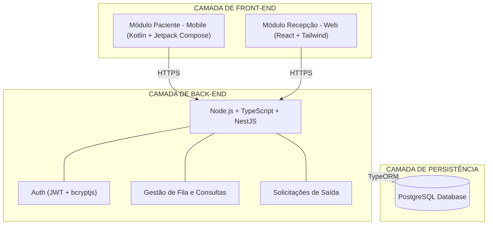

# 🏗️ Arquitetura do Sistema e Stack Tecnológica

[⬅ Voltar ao README Principal](../README.md)

---

## 📌 Sumário
- [1. Visão Geral e Estilo Arquitetural](#1-visão-geral-e-estilo-arquitetural)
- [2. Módulos do Sistema](#2-módulos-do-sistema)
- [3. Tecnologias Utilizadas (Stack Justificada)](#3-tecnologias-utilizadas-stack-justificada)
- [4. Estrutura de Repositórios e Submódulos](#4-estrutura-de-repositórios-e-submódulos)

---

## 1. Visão Geral e Estilo Arquitetural

O sistema **Saude Digital** adota o padrão **Cliente-Servidor em Três Camadas**, separando com clareza as interfaces de apresentação, a lógica de negócio via API REST e a camada de persistência de dados:



---

## 2. Módulos do Sistema

O back-end em **NestJS** foi modularizado para simplificar o desenvolvimento independente, os testes automatizados e a manutenibilidade:

### 2.1 Módulo de Autenticação e Perfil (`auth` e `paciente-app`)
- Gerencia a autenticação dos atendentes da UBS (`POST /auth/login`) e consulta/edição de perfil e senha (`GET /auth/me`, `PATCH /auth/me`, `PATCH /auth/senha`) utilizando **JWT** (`@nestjs/jwt`) e hash de senha com **`bcryptjs`**.
- Gerencia também o acesso do paciente no aplicativo Android (`POST /paciente/login`, usando CPF ou e-mail, e `GET /paciente/me`), além da redefinição de senha do paciente pelo atendente (`PATCH /pacientes/:id/senha`).

### 2.2 Módulo de Gestão da Fila (`fila` e `paciente-app`)
- Lista os profissionais da unidade (`GET /fila/profissionais`) e organiza a fila ativa por profissional e ordem de chegada (`dataHoraChegada: 'ASC'`), considerando atendimentos com status `AGUARDANDO`, `EM_TRIAGEM` e `EM_ATENDIMENTO` (`GET /fila`, `GET /fila/:id`, `POST /fila`).
- Permite ao atendente atualizar o status (`PATCH /fila/:id/status`) ou remover um paciente da fila marcando-o como `CANCELADO` (`PATCH /fila/:id/remover`).
- Disponibiliza ao aplicativo do paciente a consulta à fila por profissional (`GET /paciente/fila`), retornando a lista com posição e destaque (`voce: true`) para o paciente autenticado.

### 2.3 Módulo de Consultas e Pacientes (`consultas` e `pacientes`)
- Permite o cadastro e busca de pacientes por nome ou CPF/identificador (`POST /pacientes`, `GET /pacientes`).
- Gerencia as consultas do dia por profissional (`GET /consultas`, `POST /consultas`) e expõe o histórico de atendimentos ao paciente autenticado no app (`GET /paciente/consultas`).

### 2.4 Módulo de Solicitações de Saída (`solicitacoes-saida`)
- Recebe pedidos de cancelamento/saída da fila enviados pelo paciente (`POST /paciente/cancelamento`) ou diretamente por atendimento (`POST /solicitacoes-saida`).
- Permite que o atendente consulte as solicitações pendentes (`GET /solicitacoes-saida`), acompanhe o contador total de pendências (`GET /solicitacoes-saida/total`) e aceite a saída em transação (`PATCH /solicitacoes-saida/:id/aceitar`), marcando a solicitação como `ACEITA` e o atendimento correspondente como `CANCELADO`.

---

## 3. Tecnologias Utilizadas (Stack Justificada)

| Camada | Tecnologia | Justificativa Técnica |
| :--- | :--- | :--- |
| **Interface Paciente (Celular)** | **Kotlin + Jetpack Compose + Material 3 (Android Nativo)** | Toolkit moderno de UI declarativa para Android. Proporciona alto desempenho nativo, animações fluidas e excelente legibilidade e contraste para o paciente. |
| **Interface Recepção (Desktop)** | **React 19 + React Router + Vite + Tailwind CSS + TypeScript** | Interface web moderna e responsiva para o computador da recepção, com roteamento estruturado e estilização rápida com Tailwind CSS. |
| **Back-end (API REST)** | **Node.js + NestJS + TypeScript + Swagger** | Arquitetura modular orientada a controladores e serviços injetáveis, com tipagem estrita em TypeScript e documentação interativa da API via Swagger (`/docs`). |
| **Autenticação e Segurança** | **JWT (`@nestjs/jwt`) + `bcryptjs`** | Emissão de tokens stateless para separar rotas de funcionários (`JwtAuthGuard`) e pacientes (`PacienteAuthGuard`), com senhas protegidas por hash bcrypt. |
| **Banco de Dados** | **PostgreSQL** | SGBD relacional robusto, confiável e compatível com transações ACID essenciais para consistência de filas e histórico de atendimentos. |
| **ORM** | **TypeORM (`@nestjs/typeorm`)** | Mapeamento objeto-relacional integrado ao NestJS para modelagem das entidades e consultas tipadas sobre o esquema SQL do PostgreSQL. |
| **Testes Automatizados** | **Vitest + Supertest** | Suíte rápida para testes unitários dos serviços/guards e testes end-to-end (E2E) das rotas da API. |

---

## 4. Estrutura de Repositórios e Submódulos

O código-fonte da solução está distribuído em submódulos Git integrados a este repositório principal:

| Repositório / Submódulo | Descrição | Tecnologia | Link |
| :--- | :--- | :--- | :--- |
| **`trabalho_ES_backend`** | API REST e persistência no PostgreSQL | Node.js / NestJS / TypeORM / PostgreSQL / JWT | [GitHub Repo](https://github.com/talle5/trabalho_ES_backend) |
| **`trabalho_ES_web`** | Painel administrativo da Recepção/Triagem | React / React Router / Vite / Tailwind CSS | [GitHub Repo](https://github.com/talle5/trabalho_ES_web) |
| **`trabalho_ES_mobile`** | Aplicativo Android nativo para os Pacientes | Kotlin / Jetpack Compose / Material 3 | [GitHub Repo](https://github.com/talle5/trabalho_ES_mobile) |

Para clonar o projeto completo com todos os submódulos:

```bash
git clone --recurse-submodules https://github.com/talle5/trabalho_ES.git
```

---

[⬅ Voltar ao README Principal](../README.md)
