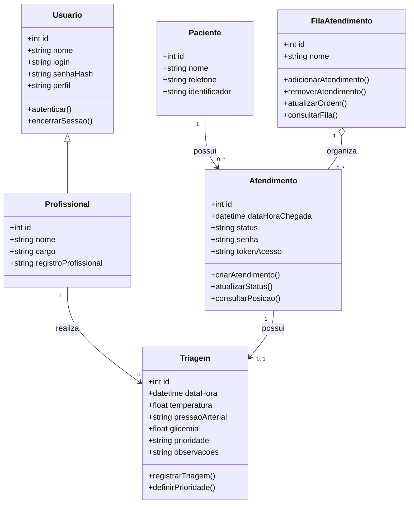

# 🧩 Diagrama de Classes

[⬅ Voltar ao README Principal](../README.md)

---

## 📌 Sumário
- [1. Representação do Diagrama de Classes](#1-representação-do-diagrama-de-classes)
- [2. Especificação em Mermaid](#2-especificação-em-mermaid)
- [3. Descrição das Classes e Métodos](#3-descrição-das-classes-e-métodos)
- [4. Relacionamentos entre as Classes](#4-relacionamentos-entre-as-classes)
- [5. Dinâmica do Domínio no Atendimento](#5-dinâmica-do-domínio-no-atendimento)

---

## 1. Representação do Diagrama de Classes

O diagrama de classes modela a estrutura de entidades, persistência e as operações centrais do domínio de triagem, controle de prioridades e filas de atendimento da UBS:

  

---

## 2. Especificação em Mermaid

---

## 3. Descrição das Classes e Métodos

### 3.1 `Usuario`
Representa os operadores com acesso autenticado ao sistema administrativo (recepção/triagem).
- **Atributos**:
  - `id`: identificador numérico único.
  - `nome`: nome completo do usuário.
  - `login`: identificação para autenticação (e-mail institucional).
  - `senhaHash`: credencial criptografada.
  - `perfil`: nível de acesso no sistema (ex.: atendente, triador, gestor).
- **Métodos**:
  - `autenticar()`: valida as credenciais e emite o token JWT de sessão.
  - `encerrarSessao()`: invalida a sessão ativa.

### 3.2 `Profissional`
Especialização da classe `Usuario`. Representa atendentes, técnicos de enfermagem, enfermeiros e médicos da UBS.
- **Herança**: estende `Usuario` (reaproveitando autenticação e perfil).
- **Atributos Adicionais**:
  - `cargo`: função exercida na UBS (ex.: Atendente, Técnico de Enfermagem).
  - `registroProfissional`: número de matrícula ou registro no conselho (COREN, CRM, etc.).

### 3.3 `Paciente`
Representa os cidadãos atendidos pela unidade de saúde.
- **Atributos**:
  - `id`: identificador único do paciente.
  - `nome`: nome completo.
  - `telefone`: contato telefônico para envio futuro de SMS/WhatsApp.
  - `identificador`: documento unívoco (Cartão Nacional de Saúde - CNS ou CPF).

### 3.4 `Atendimento`
Registra a jornada do paciente durante uma visita específica à UBS.
- **Atributos**:
  - `id`: identificador único do ciclo de atendimento.
  - `dataHoraChegada`: carimbo de data e hora do registro de entrada.
  - `status`: situação atual (`Aguardando` → `Em atendimento` → `Finalizado` ou `Cancelado`).
  - `senha`: código alfanumérico visível da chamada.
  - `tokenAcesso`: token de autenticação individual utilizado pelo aplicativo mobile (Jetpack Compose) para vincular e consultar a fila do paciente com segurança.
- **Métodos**:
  - `criarAtendimento()`: instancia uma nova entrada de atendimento.
  - `atualizarStatus()`: altera a etapa do paciente no fluxo.
  - `consultarPosicao()`: calcula e devolve a colocação atual do atendimento na fila.

### 3.5 `Triagem`
Armazena a avaliação clínica preliminar realizada antes do atendimento médico.
- **Atributos**:
  - `id`: identificador único da triagem.
  - `dataHora`: momento de realização da aferição.
  - `temperatura`: temperatura corporal aferida (°C).
  - `pressaoArterial`: pressão arterial (ex.: `120/80 mmHg`).
  - `glicemia`: índice glicêmico verificado.
  - `prioridade`: classificação de risco (convencional, prioridade legal ou emergencial).
  - `observacoes`: anotações de sintomas e queixas do paciente.
- **Métodos**:
  - `registrarTriagem()`: persiste as medições aferidas.
  - `definirPrioridade()`: estabelece o peso de ordenação da fila com base nos dados clínicos.

### 3.6 `FilaAtendimento`
Controla a organização dinâmica da sequência de pacientes para cada médico/especialidade da UBS.
- **Atributos**:
  - `id`: identificador único da fila.
  - `nome`: identificação do consultório ou profissional (ex.: *Dr. Ricardo Mendes - Clínico Geral*).
- **Métodos**:
  - `adicionarAtendimento()`: insere um novo atendimento na fila conforme a prioridade.
  - `removerAtendimento()`: desassocia um atendimento por desistência ou finalização.
  - `atualizarOrdem()`: recalcula dinamicamente a ordenação considerando intercalação de prioridades.
  - `consultarFila()`: retorna o estado atual da lista de espera.

---

## 4. Relacionamentos entre as Classes

- **`Usuario <|-- Profissional` (Herança)**: todo profissional de saúde é um usuário com permissões administrativas e credenciais.
- **`Paciente 1 ──> 0..* Atendimento` (Associação)**: um paciente pode possuir múltiplos atendimentos ao longo do tempo, mantendo histórico de visitas.
- **`Profissional 1 ──> 0..* Triagem` (Associação)**: um profissional pode conduzir a triagem de múltiplos pacientes ao longo do seu turno.
- **`Atendimento 1 ──> 0..1 Triagem` (Associação)**: cada atendimento possui no máximo uma avaliação de triagem associada.
- **`FilaAtendimento 1 ──◇ 0..* Atendimento` (Agregação)**: a fila agrupa dinamicamente múltiplos atendimentos ativos; o atendimento existe independente da fila.

---

## 5. Dinâmica do Domínio no Atendimento

A interação entre as classes reflete a jornada real na UBS:

$$\text{Paciente} \longrightarrow \text{Atendimento} \longrightarrow \text{Triagem} \longrightarrow \text{FilaAtendimento} \longrightarrow \text{Notificação ao Celular}$$

1. O paciente chega à UBS e seu **Atendimento** é registrado.
2. O profissional realiza a **Triagem** e registra os sinais vitais, definindo a prioridade.
3. O atendimento é integrado à **FilaAtendimento**, gerando o `tokenAcesso`.
4. O paciente acompanha o avanço pelo seu smartphone e é notificado quando for chamado.

---

[⬅ Voltar ao README Principal](../README.md)
